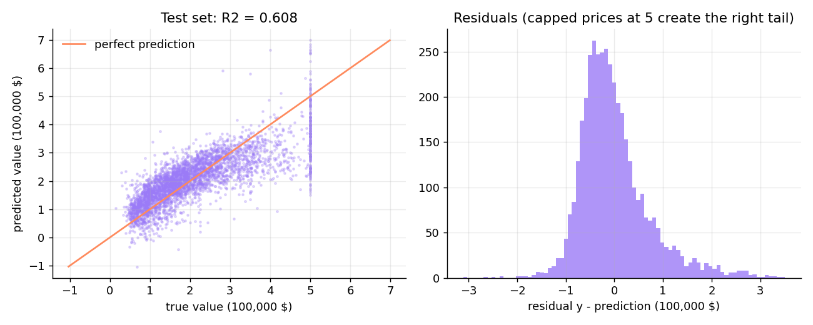
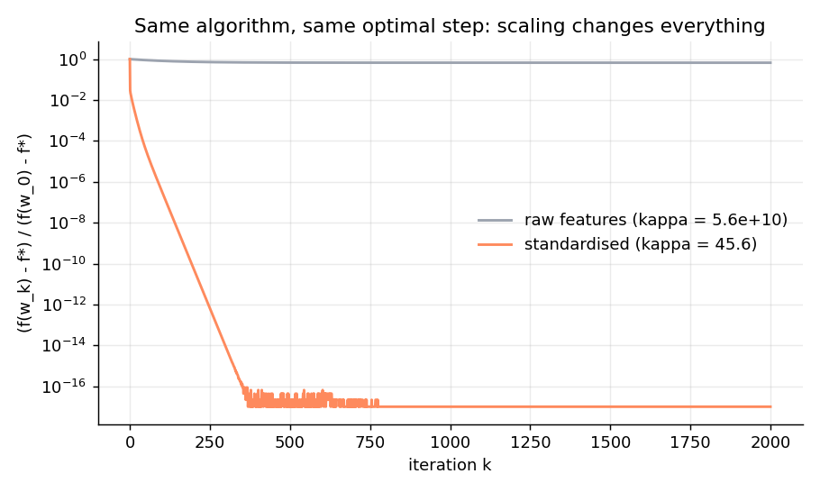
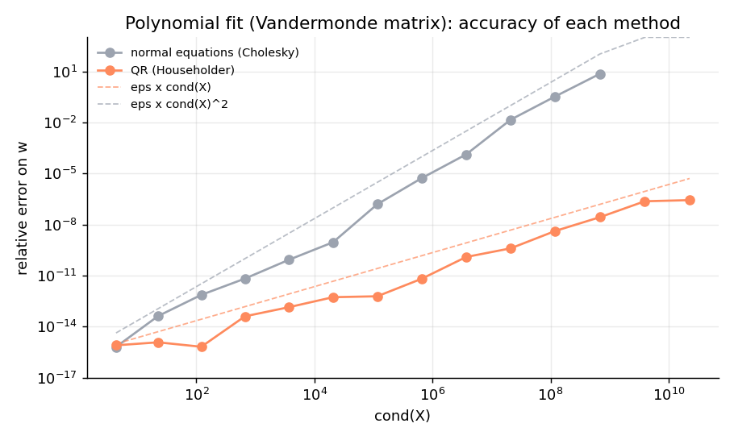

# Régression linéaire et descente de gradient, sans bibliothèque de ML


*English summary: [README_EN.md](README_EN.md)* · **Rapport complet (LaTeX) : [report/rapport.pdf](report/rapport.pdf)**

Projet personnel en Python (NumPy, Matplotlib). Je résous le problème des moindres carrés de trois façons, **programmées moi-même à partir des seules opérations matricielles de NumPy**, puis je les valide sur un jeu de données réel en les comparant à `scikit-learn` (utilisé uniquement pour cette comparaison).

- **Équations normales** $X^\top X\,w = X^\top y$, résolues par une factorisation de **Cholesky** écrite à la main.
- **Décomposition QR** par réflexions de **Householder**, plus stable numériquement.
- **Descente de gradient** : étude du **pas** (convergence si et seulement si $\eta < 2/L$, pas optimal $2/(L+\mu)$) et de la **vitesse de convergence** $\left(\frac{\kappa-1}{\kappa+1}\right)^k$, plus une variante à pas d'Armijo.

## Résultats sur California Housing

20 433 îlots du recensement californien, 8 variables (revenu médian, âge des logements, pièces par foyer, population, latitude, longitude…), découpage 80 % / 20 %.

| Méthode | RMSE test | $R^2$ test | Écart max. avec scikit-learn |
|---|---|---|---|
| Équations normales (Cholesky) | 72 495 \$ | 0,6076 | $1{,}3 \times 10^{-14}$ |
| QR (Householder) | 72 495 \$ | 0,6076 | $2{,}0 \times 10^{-13}$ |
| Descente de gradient (479 itérations) | 72 495 \$ | 0,6076 | $1{,}9 \times 10^{-10}$ |
| scikit-learn `LinearRegression` | 72 495 \$ | 0,6076 | – |

Les trois méthodes retrouvent les coefficients de scikit-learn à moins de $10^{-9}$ près.



## Descente de gradient : le pas et la convergence

Pour $f(w) = \frac1n\lVert Xw-y\rVert^2$, la hessienne est $H = \frac2n X^\top X$. Avec $\mu$ et $L$ ses valeurs propres extrêmes, l'erreur vérifie $\lVert w_k - w^\star\rVert \le \rho^k \lVert w_0 - w^\star\rVert$ où $\rho = \max(|1-\eta\mu|, |1-\eta L|)$ (démonstration dans le rapport). Ici $\mu = 0{,}089$, $L = 4{,}06$, $\kappa = 45{,}6$.

| Pas $\eta$ | Taux théorique | Taux mesuré | Itérations pour $f-f^\star < 10^{-10}$ |
|---|---|---|---|
| $0{,}1/L$ | 0,9978 | 0,9964 | > 600 |
| $1/L$ | 0,9781 | 0,9776 | 414 |
| $2/(L+\mu)$ (optimal) | 0,9571 | 0,9569 | 212 |
| $1{,}9/L$ | 0,9583 | 0,9581 | 216 |
| $2{,}05/L$ | 1,0500 | 1,0500 | diverge |


**La standardisation des variables est décisive** : sans elle, $\kappa \approx 5{,}6 \times 10^{10}$ et la descente de gradient n'a quasiment pas progressé après 2 000 itérations ; avec, elle atteint la précision machine en moins de 400.



## Stabilité numérique : QR contre équations normales

Former $X^\top X$ élève le conditionnement au carré : $\mathrm{cond}(X^\top X) = \mathrm{cond}(X)^2$. Sur une régression polynomiale (matrice de Vandermonde, données exactes) :

| Degré | cond(X) | Erreur, équations normales | Erreur, QR |
|---|---|---|---|
| 8 | $6{,}6 \times 10^{5}$ | $5{,}3 \times 10^{-6}$ | $6{,}4 \times 10^{-12}$ |
| 12 | $6{,}9 \times 10^{8}$ | $7{,}2$ (plus aucun chiffre exact) | $2{,}7 \times 10^{-8}$ |
| 14 | $2{,}3 \times 10^{10}$ | échec : $X^\top X$ n'est plus définie positive | $2{,}7 \times 10^{-7}$ |



## Structure

```
linreg/
  linalg.py            Cholesky, substitutions, QR de Householder (écrits à la main)
  least_squares.py     équations normales, QR, prédiction
  gradient_descent.py  descente de gradient : pas fixe, pas optimal, Armijo
  metrics.py           MSE, RMSE, MAE, R²
  data.py              chargement de California Housing, découpage, standardisation
experiments/run_all.py lance toutes les expériences et génère figures/, results.md et report/generated.tex
report/rapport.tex     rapport LaTeX (les valeurs numériques sont générées automatiquement)
tests/                 13 tests : QR orthogonale, Cholesky, convergence, divergence pour η > 2/L, accord avec scikit-learn
data/housing.csv       données (R. K. Pace et R. Barry, 1997)
```

## Utilisation

```bash
pip install -r requirements.txt
python experiments/run_all.py              # régénère figures, résultats et tableaux du rapport
pytest                                     # lance les tests
cd report && pdflatex rapport.tex          # recompile le rapport
```

## Pistes

Régression ridge (qui améliore le conditionnement de $X^\top X$), descente de gradient stochastique, gradient accéléré de Nesterov (taux en $\sqrt\kappa$), variables non linéaires.

## Auteur

**Yassine Abderrezak Dache**, licence d'informatique (USTHB) · [GitHub @yassinedache](https://github.com/yassinedache) · Licence MIT
