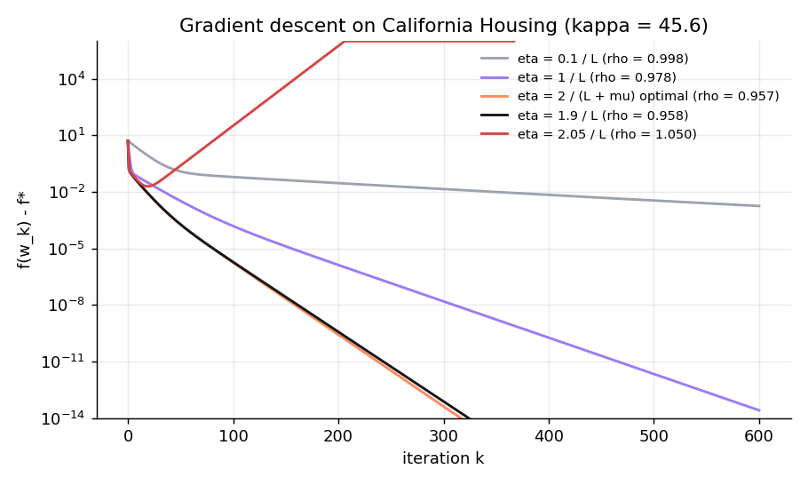

# Linear regression and gradient descent, without ML libraries


*Version française et détails : [README.md](README.md) · Full report (in French): [report/rapport.pdf](report/rapport.pdf)*

Personal project in Python (NumPy, Matplotlib). The least-squares problem is solved three ways, **written from scratch using only NumPy's array operations**, then validated on a real dataset against `scikit-learn` (used only for that comparison):

- **Normal equations** $X^\top X\,w = X^\top y$, solved with a hand-written **Cholesky** factorisation.
- **Householder QR** decomposition, which is numerically more stable.
- **Gradient descent**, with a study of the **step size** (converges iff $\eta < 2/L$, optimal step $2/(L+\mu)$) and of the **convergence rate** $\left(\frac{\kappa-1}{\kappa+1}\right)^k$, plus an Armijo line-search variant.

## Key results

- **California Housing** (20,433 block groups, 8 features, 80/20 split): all three methods reach test $R^2 = 0.6076$ and RMSE = 72,495 $, matching scikit-learn's coefficients to within $10^{-9}$.
- **Step size**: measured convergence rates match the theoretical rate $\max(|1-\eta\mu|, |1-\eta L|)$ (e.g. 0.9569 measured vs 0.9571 predicted for the optimal step), and the method diverges for $\eta = 2.05/L$.
- **Feature scaling**: without standardisation $\kappa \approx 5.6 \times 10^{10}$ and gradient descent barely moves in 2,000 iterations; with it, $\kappa = 45.6$ and it reaches machine precision in under 400.
- **Stability**: on an ill-conditioned polynomial fit, the normal equations lose every significant digit (error ~ $\varepsilon\,\mathrm{cond}(X)^2$) while QR stays accurate (error ~ $\varepsilon\,\mathrm{cond}(X)$).



## Usage

```bash
pip install -r requirements.txt
python experiments/run_all.py   # figures, results.md and the report's tables
pytest                          # 13 tests
```

Author: **Yassine Abderrezak Dache**, BSc in Computer Science (USTHB). MIT licence. Data: R. K. Pace and R. Barry (1997).
